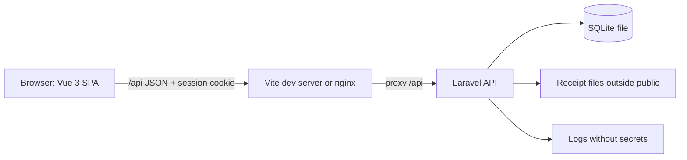

# Design: ExpenseDesk

## Overview

ExpenseDesk is one internal web app for one Indian company: 150 Employees submit expense reports with receipts, 12 Managers approve, request changes or reject them, 3 Finance staff record reimbursements, and Administrators manage users, manager assignments and categories. It replaces spreadsheets and email receipts with one audited workflow.

The app is two packages in one repository:

- `frontend/` — Vue 3 with TypeScript, Vite and Vue Router. A single-page app that talks to the API only through `/api`.
- `backend/` — PHP with Laravel, a REST API under `/api`, SQLite as the database (one file on the server), receipts on disk outside the public web directory.

In development Vite serves the frontend on one port and proxies `/api` to the Laravel server on another. In production one HTTPS origin serves the compiled frontend from `backend/public/` and the API under `/api`.

Scale: about 2,000 reports per month, up to 25 people working at the same time, one server. SQLite in WAL mode with a busy timeout handles that load; every write is short and wrapped in a transaction.

## Architecture

- **Frontend** (`frontend/`): Vue 3 + TypeScript, Vue Router, Pinia for the signed-in person and small shared state, `fetch` wrapper in `frontend/src/api/client.ts` that sends the CSRF token and the session cookie, and turns 401 into a redirect to `/sign-in`.
- **Backend** (`backend/`): Laravel 11, routes in `backend/routes/api.php`, controllers in `backend/app/Http/Controllers/Api/`, form requests for validation, policies for access control, Eloquent models, migrations in `backend/database/migrations/`.
- **Database**: SQLite file at `backend/database/database.sqlite` in development, at a path from `DB_DATABASE` in production. `PRAGMA foreign_keys = ON` on every connection, `PRAGMA journal_mode = WAL`, `PRAGMA busy_timeout = 5000`.
- **Receipts**: stored under `backend/storage/app/receipts/<report_id>/<uuid>.<ext>`, never under `backend/public/`. Served only through `GET /api/receipts/{id}` after the policy check.
- **Sessions**: Laravel's database session driver (table `sessions`), cookie `expensedesk_session`, HttpOnly, SameSite=Lax, Secure in production.
- **CSRF**: Laravel's `VerifyCsrfToken` middleware on every state-changing route; the SPA reads the `XSRF-TOKEN` cookie and sends `X-XSRF-TOKEN`.

## Components and Interfaces

### Frontend routes

| Path | Screen | Who |
| --- | --- | --- |
| `/` | redirects to `/sign-in` when signed out, else the first screen of the highest role | anyone |
| `/sign-in` | Sign-in page | anyone |
| `/forgot-password` | Forgot password page | anyone |
| `/reset-password/:token` | Reset password page | anyone with a link |
| `/dashboard` | Employee dashboard | Employee |
| `/reports/new` | Report editor, empty draft | Employee |
| `/reports/:id/edit` | Report editor for a Draft or Changes requested report | Employee (own) |
| `/reports/:id` | Report details | Employee (own), Manager (assigned), Finance, Administrator |
| `/approvals` | Manager approval inbox | Manager |
| `/finance` | Finance dashboard | Finance |
| `/admin/users` | Administration users | Administrator |
| `/admin/categories` | Administration categories | Administrator |
| `/admin/audit` | Administration audit history | Administrator |

First screen after sign-in, by highest role: Administrator → `/admin/users`, Finance → `/finance`, Manager → `/approvals`, Employee → `/dashboard`.

### Frontend files

- `frontend/src/main.ts`, `frontend/src/App.vue`, `frontend/src/router/index.ts` — app shell, router, route guards by role.
- `frontend/src/stores/auth.ts` — the signed-in person (`id`, `name`, `email`, `roles`, `manager_id`), loaded from `GET /api/me`.
- `frontend/src/api/client.ts` — `get`, `post`, `put`, `patch`, `del`, `upload`; throws `ApiError { status, message, errors }`.
- `frontend/src/lib/money.ts` — `formatInr(paise)` → `₹2,000.75`; `parseInr(text)` → paise.
- `frontend/src/lib/dates.ts` — `formatDateTime(utcIso)` → Asia/Kolkata `dd MMM yyyy, HH:mm`; `formatDate(isoDate)` → `dd MMM yyyy`; `todayInKolkata()`.
- `frontend/src/components/` — `AppShell.vue` (header, navigation, sign out), `StatusBadge.vue`, `DataTable.vue` (sortable header row), `EmptyState.vue`, `LoadingState.vue`, `ErrorState.vue`, `ConfirmDialog.vue`, `ToastHost.vue`.
- Screens: `frontend/src/views/SignInView.vue`, `ForgotPasswordView.vue`, `ResetPasswordView.vue`, `EmployeeDashboardView.vue`, `ReportEditorView.vue`, `ReportDetailsView.vue`, `ApprovalInboxView.vue`, `FinanceDashboardView.vue`, `AdminUsersView.vue`, `AdminCategoriesView.vue`, `AdminAuditView.vue`, each with its own `<style scoped>` or CSS module beside it.

### Backend files

- `backend/routes/api.php` — every route below.
- `backend/routes/web.php` — `/api/health` is in `api.php`; `web.php` serves the SPA fallback in production.
- `backend/app/Http/Controllers/Api/AuthController.php`, `ReportController.php`, `ReportLineController.php`, `ReceiptController.php`, `DecisionController.php`, `ReimbursementController.php`, `FinanceController.php`, `ExportController.php`, `AdminUserController.php`, `CategoryController.php`, `AuditController.php`, `HealthController.php`.
- `backend/app/Http/Requests/` — `StoreReportRequest`, `UpdateReportRequest`, `StoreLineRequest`, `DecisionRequest`, `ReimbursementRequest`, `ReassignRequest`, `StoreUserRequest`, `UpdateUserRequest`, `StoreCategoryRequest`.
- `backend/app/Policies/ReportPolicy.php`, `ReceiptPolicy.php`, `ReimbursementPolicy.php`, `UserPolicy.php`.
- `backend/app/Models/User.php`, `Report.php`, `ReportLine.php`, `Receipt.php`, `Reimbursement.php`, `Category.php`, `AuditEvent.php`.
- `backend/app/Services/ReportService.php` (totals, submission, decisions), `ReimbursementService.php` (single payment under contention), `AuditService.php` (writes events inside the caller's transaction), `ReceiptStorage.php`.
- `backend/app/Http/Middleware/EnsureActiveSession.php` — 401 when the session's user is deactivated.
- `backend/app/Http/Middleware/RetryOnBusyDatabase.php` — retries a request up to 5 seconds on `SQLITE_BUSY`, then 503 `The system is busy. Try again.`
- `backend/database/seeders/DevelopmentSeeder.php` — sample data and the test logins, refuses to run when `APP_ENV=production`.

### API endpoints

All paths are under `/api`. Every response is JSON. Errors use `{ "message": string, "errors": { "<field>": [string] } }` where `errors` applies. State-changing requests need the `X-XSRF-TOKEN` header.

#### Auth

| Method | Path | Body | Answer |
| --- | --- | --- | --- |
| GET | `/api/csrf-cookie` | — | 204, sets `XSRF-TOKEN` |
| POST | `/api/login` | `email`, `password` | 200 `{ user }`; 422 `{ message: "Email or password is incorrect" }`; 429 `{ message: "Too many attempts. Try again in 15 minutes." }` |
| POST | `/api/logout` | — | 204 |
| GET | `/api/me` | — | 200 `{ user }`; 401 |
| POST | `/api/forgot-password` | `email` | 200 `{ message: "If that email has an account, a reset link has been sent" }` |
| POST | `/api/reset-password` | `token`, `password`, `password_confirmation` | 200 `{ message }`; 422 `{ message: "This reset link is no longer valid" }` |

`user` is `{ id, name, email, roles: string[], manager_id: number|null, active: boolean }`, `roles` from `Employee`, `Manager`, `Finance`, `Administrator`.

#### Reports

| Method | Path | Body | Answer |
| --- | --- | --- | --- |
| GET | `/api/reports` | query `status?`, `scope?` (`mine` default) | 200 `{ data: ReportSummary[] }` |
| POST | `/api/reports` | `title?`, `business_purpose?` | 201 `{ data: Report }` |
| GET | `/api/reports/{id}` | — | 200 `{ data: Report }`; 403 `{ message: "You do not have access to this report" }` |
| PATCH | `/api/reports/{id}` | `title?`, `business_purpose?` | 200 `{ data: Report }`; 422 when not Draft or Changes requested |
| POST | `/api/reports/{id}/submit` | — | 200 `{ data: Report }`; 422 `{ errors: { "lines.0.receipt": ["Receipt required"], ... } }` |
| GET | `/api/reports/{id}/audit` | — | 200 `{ data: AuditEvent[] }` |

`ReportSummary` = `{ id, title, status, total_paise, updated_at, submitted_at, employee: { id, name }, manager: { id, name } | null, waiting_days }`.

`Report` = `{ id, title, business_purpose, status, total_paise, employee, manager, submitted_at, decided_at, paid_at, created_at, updated_at, lines: Line[], reimbursement: Reimbursement|null, audit: AuditEvent[] }`.

`Line` = `{ id, expense_date, category: { id, name }, merchant, amount_paise, note, receipt: { id, file_name, mime_type, size } | null }`.

`AuditEvent` = `{ id, action, actor: { id, name }, created_at, from_status, to_status, reason, previous_manager, new_manager, amount_paise, payment_date, payment_reference }` (fields not applying are `null`).

#### Lines and receipts

| Method | Path | Body | Answer |
| --- | --- | --- | --- |
| POST | `/api/reports/{id}/lines` | `expense_date`, `category_id`, `merchant`, `amount_paise`, `note?` | 201 `{ data: Line }`; 422 |
| PATCH | `/api/reports/{id}/lines/{lineId}` | same fields, all optional | 200 `{ data: Line }`; 422 |
| DELETE | `/api/reports/{id}/lines/{lineId}` | — | 204 |
| POST | `/api/reports/{id}/lines/{lineId}/receipt` | multipart `file` | 201 `{ data: Receipt }`; 422 `{ errors: { file: ["Receipts must be a PDF, JPEG or PNG of up to 5 MB"] } }` |
| DELETE | `/api/reports/{id}/lines/{lineId}/receipt` | — | 204 |
| GET | `/api/receipts/{id}` | — | 200 the file with its `Content-Type`; 403 `{ message: "You do not have access to this report" }` |

#### Decisions

| Method | Path | Body | Answer |
| --- | --- | --- | --- |
| POST | `/api/reports/{id}/decision` | `decision`: `approve` \| `request_changes` \| `reject`, `reason?` | 200 `{ data: Report }`; 422 `{ errors: { reason: ["Reason must be at least 10 characters"] } }`; 403 `{ message: "You cannot decide on your own report" }`; 409 `{ message: "This report was already decided by <name> as <status>", data: Report }` |

#### Finance

| Method | Path | Body | Answer |
| --- | --- | --- | --- |
| GET | `/api/finance/summary` | query `from`, `to` (dates, default current month) | 200 `{ outstanding_paise, outstanding_count, paid_paise, paid_count, from, to }` |
| GET | `/api/finance/outstanding` | — | 200 `{ data: ReportSummary[] }` |
| GET | `/api/finance/payments` | query `from`, `to`, `q?` | 200 `{ data: Payment[] }` |
| POST | `/api/reports/{id}/reimbursement` | `payment_date`, `payment_reference` | 201 `{ data: Reimbursement }`; 409 `{ message: "This report was already paid" }`; 422 `{ errors: { payment_date: ["Payment date cannot be in the future"] } }` |
| GET | `/api/finance/export.csv` | query `from`, `to`, `q?` | 200 `text/csv` attachment `expensedesk-payments.csv` |

`Payment` = `{ id, report_id, amount_paise, payment_date, payment_reference, employee: { id, name }, report_title, recorded_by: { id, name }, created_at }`.

#### Administration

| Method | Path | Body | Answer |
| --- | --- | --- | --- |
| GET | `/api/admin/users` | — | 200 `{ data: AdminUser[] }` |
| POST | `/api/admin/users` | `name`, `email`, `roles: string[]`, `password` | 201 `{ data: AdminUser }`; 422 |
| PATCH | `/api/admin/users/{id}` | `name?`, `email?`, `roles?`, `manager_id?`, `active?` | 200 `{ data: AdminUser }` |
| POST | `/api/admin/reports/{id}/reassign` | `manager_id`, `reason` | 200 `{ data: Report }`; 422 `{ errors: { reason: [...] } }` |
| GET | `/api/admin/categories` | — | 200 `{ data: Category[] }` |
| POST | `/api/admin/categories` | `name` | 201 `{ data: Category }` |
| PATCH | `/api/admin/categories/{id}` | `name?`, `active?` | 200 `{ data: Category }` |
| GET | `/api/admin/audit` | query `report_id?`, `page?` | 200 `{ data: AuditEvent[], meta: { current_page, last_page, total } }` |
| GET | `/api/categories` | — | 200 `{ data: Category[] }` — active categories only, for the report editor |

`AdminUser` = `{ id, name, email, roles, manager_id, manager_name, active, created_at }`.

#### Health

| Method | Path | Answer |
| --- | --- | --- |
| GET | `/api/health` | 200 `{ "status": "ok" }` when `SELECT 1` on the database succeeds; 503 `{ "status": "error" }` when it fails |

### Shared state between screens

- The signed-in person lives in `frontend/src/stores/auth.ts`, loaded once from `GET /api/me` and refreshed after sign-in and sign-out. Route guards read `roles` from it.
- After any change that alters a report (save, submit, decision, payment, reassignment) the screen calls `router.push` to the report details or back to its list, and the list screen reloads from the API on mount. There is no client-side cache to invalidate.
- The Finance dashboard keeps its selected period and search text in the URL query (`?from=&to=&q=`), so Export CSV sends the same query to `/api/finance/export.csv`.

## Data Models

SQLite, all money as integer paise, all timestamps as UTC `datetime` strings, all calendar dates as `date` strings (`YYYY-MM-DD`).

### users

| Column | Type | Notes |
| --- | --- | --- |
| id | integer PK | |
| name | text | |
| email | text unique | lower-cased |
| password | text | bcrypt hash |
| manager_id | integer FK users.id null | the Employee's assigned Manager |
| active | integer bool | default 1 |
| created_at, updated_at | datetime | UTC |

Indexes: `users(email)` unique, `users(manager_id)`.

### roles and role_user

`roles(id, name unique)` seeded with `Employee`, `Manager`, `Finance`, `Administrator`. `role_user(user_id, role_id)` primary key `(user_id, role_id)`. A person may hold several roles.

### categories

`id`, `name` unique, `active` bool default 1, `created_at`, `updated_at`. Seeded with Travel, Meals, Accommodation, Office Supplies, Other. Deactivating sets `active = 0`; lines keep their `category_id`.

### reports

| Column | Type | Notes |
| --- | --- | --- |
| id | integer PK | |
| employee_id | integer FK users.id | |
| manager_id | integer FK users.id null | assigned at submission |
| title | text null | |
| business_purpose | text null | |
| status | text | `draft`, `submitted`, `approved`, `changes_requested`, `rejected`, `paid` |
| total_paise | integer | recomputed from lines on every line change and on submit |
| submitted_at, decided_at, paid_at | datetime null | UTC |
| created_at, updated_at | datetime | UTC |

Indexes: `reports(employee_id, status)`, `reports(manager_id, status, submitted_at)`, `reports(status, paid_at)`.

### report_lines

`id`, `report_id` FK reports.id (cascade delete), `expense_date` date, `category_id` FK categories.id, `merchant` text, `amount_paise` integer, `note` text null, `created_at`, `updated_at`. Index `report_lines(report_id)`.

### receipts

`id`, `report_line_id` FK report_lines.id unique (cascade delete), `path` text (relative to the receipts root), `file_name` text, `mime_type` text, `size` integer, `created_at`. The unique index gives one receipt per line.

### reimbursements

| Column | Type | Notes |
| --- | --- | --- |
| id | integer PK | |
| report_id | integer FK reports.id **unique** | one payment per report |
| amount_paise | integer | equals the report's approved total |
| payment_date | date | |
| payment_reference | text | at least 3 characters |
| recorded_by | integer FK users.id | |
| created_at | datetime | UTC |

The unique index on `report_id` is what makes a double-click, a retry or two Finance users at once create exactly one reimbursement.

### audit_events

| Column | Type | Notes |
| --- | --- | --- |
| id | integer PK | |
| report_id | integer FK reports.id | |
| actor_id | integer FK users.id | |
| action | text | `submitted`, `approved`, `changes_requested`, `rejected`, `reassigned`, `paid` |
| from_status, to_status | text null | |
| reason | text null | |
| previous_manager_id, new_manager_id | integer FK users.id null | |
| amount_paise | integer null | for `paid` |
| payment_date | date null | for `paid` |
| payment_reference | text null | for `paid` |
| created_at | datetime | UTC, no `updated_at` |

Indexes: `audit_events(report_id, id)`, `audit_events(created_at)`. The model has no update or delete path; `PATCH`/`DELETE` on `/api/audit-events/{id}` answer 405.

### password_reset_tokens

`email` PK, `token` (hashed), `created_at`. A token is valid for 60 minutes and is deleted when used.

### sessions

Laravel's database session table: `id`, `user_id`, `ip_address`, `user_agent`, `payload`, `last_activity`. Deactivating a user deletes their rows here, which ends every session they hold.

## Error Handling

- **Validation** — form requests answer 422 with `errors` keyed by field path (`lines.0.amount_paise`, `lines.2.receipt`), so the report editor shows each message beside the affected line. The editor keeps every entered value on a failed save, upload or submit.
- **Access** — policies answer 403 with `You do not have access to this report` (reports, receipts, reimbursements) or `You do not have access to this page` (Administration). No content is returned with a 403.
- **Session** — no session, or a session whose user is deactivated, answers 401; the client clears the auth store and redirects to `/sign-in`.
- **CSRF** — a state-changing request without the token answers 419.
- **Conflicts** — a decision on a report that is no longer Submitted answers 409 with the current report; a payment on a report that is already Paid answers 409 `This report was already paid`. Both are produced by a conditional update inside a transaction (`UPDATE reports SET status = ... WHERE id = ? AND status = ?`), so the first valid action wins and the second is told what changed.
- **Database busy** — `RetryOnBusyDatabase` retries on `SQLITE_BUSY` for up to 5 seconds, then answers 503 `The system is busy. Try again.`
- **Unexpected errors** — 500 with `{ "message": "Something went wrong. Try again." }`; the detail goes to the log with passwords, reset tokens and receipt contents redacted (`backend/config/logging.php` and a `RedactSecrets` processor).
- **Frontend** — `ApiError` carries `status`, `message` and `errors`; screens show `message` in an error state with a Try again button, and field errors beside their fields.

## Testing Strategy

- **PHP API tests** (`backend/tests/Feature/`) with PHPUnit and Laravel's testing helpers, on a separate SQLite database created per run in a temporary folder (`DB_DATABASE=:memory:` or a temp file), migrations applied by `RefreshDatabase`. They cover every endpoint, every 401/403/419/422/409 answer, the totals in paise, the single reimbursement under two concurrent requests (two connections, one unique index), and the audit event written in the same transaction.
- **Vue component tests** (`frontend/src/**/__tests__/`) with Vitest and `@vue/test-utils`, mocking `frontend/src/api/client.ts`. They cover the running total, the per-line validation messages, the money and date formatters, the CSV filter query, and the loading, empty and error states.
- **Browser tests** (`e2e/`) with `@playwright/test`, run against the running app by `run_journeys`: the Employee journey (sign in, create, upload, submit), the Manager journey (inbox, request changes, approve), the Finance journey (outstanding, record payment, export CSV), and the access-control journey (another Employee's report URL).
- **Property tests** are not part of this spec; each task's own tests check its criteria.

## Build and run

Install: npm install
Test: npm test
Run locally: yes
Dev: npm run dev
Port variable: PORT
Health path: /api/health
Deploy: ssh-docker

`npm install` at the root installs the frontend packages and runs `composer install` in `backend/` through a `postinstall` script. `npm test` runs `npm run test:backend` (PHPUnit) and `npm run test:frontend` (Vitest, `vitest run`) once each and exits. `npm run dev` starts the Laravel API on `API_PORT` (default 8000) and Vite on `PORT`, with Vite's `server.proxy` sending `/api` to `http://127.0.0.1:${API_PORT}`; both listen on `127.0.0.1`. The dev script runs `php artisan migrate --force` and the development seeder first, which seeds an empty database and leaves a seeded one as it is.

## Test logins

| Role | Email | Password |
| --- | --- | --- |
| Administrator | admin@expensedesk.test | AdminPassw0rd!2026 |
| Finance | finance@expensedesk.test | FinancePassw0rd!2026 |
| Manager | manager@expensedesk.test | ManagerPassw0rd!2026 |
| Employee | employee@expensedesk.test | EmployeePassw0rd!2026 |

The seeder creates these four accounts, plus a second Manager, a second Employee with a Draft, a Submitted and a Paid report, and the five categories. It never runs when `APP_ENV=production`. The live app's first Administrator comes from `FIRST_ADMIN_EMAIL` and `FIRST_ADMIN_PASSWORD` in `.env.example`, created after the migrations when both are set and no account exists.

## Look and feel

A clean, modern internal tool: calm neutral surfaces, one confident indigo for the main action, money in a tabular font so columns line up.

- **Colours** — background `#F5F6FA`, surface `#FFFFFF`, text `#1B1F2A`, muted text `#5B6273`, border `#E2E5EE`, primary `#3B4CCA`, primary hover `#2F3DA8`, primary pressed `#26318A`, error `#C62828`, error surface `#FDECEC`, success `#1B7F4B`, success surface `#E8F5EE`, warning `#8A5A00`, warning surface `#FFF4DC`.
- **Font** — `Inter, "Segoe UI", system-ui, sans-serif` at 15px base, 1.5 line height; headings 600 weight; amounts in `"Roboto Mono", ui-monospace, monospace` with `font-variant-numeric: tabular-nums`.
- **Spacing** — 4px scale: 4, 8, 12, 16, 24, 32, 48. Page padding 16px on a phone, 32px on a desktop; content max width 1200px.
- **Radius** — 8px for fields and buttons, 12px for cards and dialogs, 999px for status badges.
- **Buttons** — primary: primary background, white text, 8px radius, 12px 20px padding, 44px minimum height; hover darkens to primary hover, pressed to primary pressed, disabled at 40% opacity with `cursor: not-allowed`. Secondary: white background, 1px border, text colour; ghost: no border, text colour. Focus: 2px outline in primary with a 2px offset on every control.
- **Fields** — white background, 1px border, 8px radius, 10px 12px padding, 44px minimum height; label above in 13px 600 weight; focus border primary plus a 3px primary-tinted ring; error border error with the message below in error colour; disabled background `#F0F1F5`.
- **Lists and tables** — cards with 12px radius and a 1px border; table header row in muted 13px uppercase with a bottom border, rows separated by 1px borders, hover row background `#F7F8FC`; sortable column headers are buttons with an arrow.
- **Status badges** — Draft grey, Awaiting approval warning, Changes requested warning, Approved success, Paid success, Rejected error; 999px radius, 12px 600 text.
- **Toasts** — bottom centre on a phone, bottom right on a desktop; success and error variants; dismissed after 5 seconds.

### Screens

- **Sign-in** — phone: a single column, the ExpenseDesk wordmark, then the card with email, password, Sign in, and the Forgot password link; desktop: the same card centred at 400px on the background. Errors appear above the button.
- **Forgot password / Reset password** — the same centred card, one field (or two password fields), one primary button, a link back to sign-in.
- **Employee dashboard** — phone: a header with the person's name and a New report button, then five status cards in a 2-column grid (the fifth full width), each with its count and total, then the report list as stacked cards (title, total, status badge, last updated). Desktop: the five cards in one row, the list as a table with columns Title, Total, Status, Last updated.
- **Report editor** — phone: title and business purpose fields, then one card per expense line with its fields stacked, a receipt row with the file name and an Add receipt button that offers the camera, a Remove line button, then Add line, the running total in a sticky bar at the bottom beside Save draft and Submit. Desktop: the same in a 720px column with the running total in a right-hand summary card.
- **Report details** — phone: title, status badge and total at the top, then the lines as cards with their receipts, then the activity history as a timeline; desktop: two columns, the report and lines on the left, the history and the decision buttons on the right.
- **Manager approval inbox** — phone: filter chips and stacked report cards; desktop: a filter bar (Employee select, date range, amount range) above a sortable table with columns Employee, Report, Submitted, Total, Waiting, and a row that opens the report details.
- **Finance dashboard** — phone: the outstanding total card, the paid-period card with its date range, then the payment history as cards; desktop: two summary cards side by side, a period picker and search field, the Export CSV button, the approved unpaid table, and the payment history table.
- **Administration users / categories / audit** — phone: stacked cards with an edit action; desktop: sortable tables with an Add button in the header and a side dialog for create and edit.

## Where the parts meet

- **Report editor → report details** — after a successful submit the editor calls `router.push('/reports/' + report.id)`; the details screen loads `GET /api/reports/{id}` and shows the `audit` array it returns.
- **Manager inbox → report details** — the inbox row links to `/reports/{id}`; the details screen shows the decision buttons only when `status === 'submitted'`, the signed-in person is the report's `manager`, and the person is not the report's `employee`.
- **Finance dashboard → payment dialog** — the dialog posts `{ payment_date, payment_reference }` to `/api/reports/{id}/reimbursement`; on 201 the dashboard reloads `GET /api/finance/summary`, `GET /api/finance/outstanding` and `GET /api/finance/payments` with the same `from`, `to`, `q`; on 409 it shows `This report was already paid` and reloads.
- **Finance dashboard → CSV export** — the Export CSV button opens `/api/finance/export.csv?from=&to=&q=` in a new navigation, so the browser downloads the file with the session cookie.
- **Administration users → report details** — the reassign dialog posts `{ manager_id, reason }` to `/api/admin/reports/{id}/reassign`; the details screen reloads and shows the new Manager and the `reassigned` audit entry.
- **Report editor → categories** — the category select loads `GET /api/categories` (active only) on mount; a category deactivated in Administration disappears from the next load and stays on lines that already use it, which the API returns with their `category.name`.
- **Any screen → sign-in** — a 401 from any request clears `frontend/src/stores/auth.ts` and pushes `/sign-in`.

## Assumptions

- The repository holds two packages, `frontend/` and `backend/`, with one root `package.json` whose scripts run both; `npm install` also runs `composer install` in `backend/`.
- Laravel 11 with PHP 8.3, and Laravel's built-in session, CSRF and rate-limiter features rather than extra packages.
- Receipts are stored under `backend/storage/app/receipts/`, outside `backend/public/`, and the backup command copies that folder with the database file.
- The production deploy target is a single application server reached over SSH, running the app in Docker with a Caddy service for HTTPS; the database file and the receipts folder are Docker volumes.
- The audit history screen lists every event newest first, paged 50 at a time; a report's own history is shown on its details screen.
- The "Waiting 3+ days" label is computed by the API as whole Asia/Kolkata days between `submitted_at` and now.
- Login rate limiting is 5 failed attempts per email per 15 minutes, kept in Laravel's cache store (the database cache table).
- The CSV export streams every matching row with no page limit, since a month holds about 2,000 payments.
